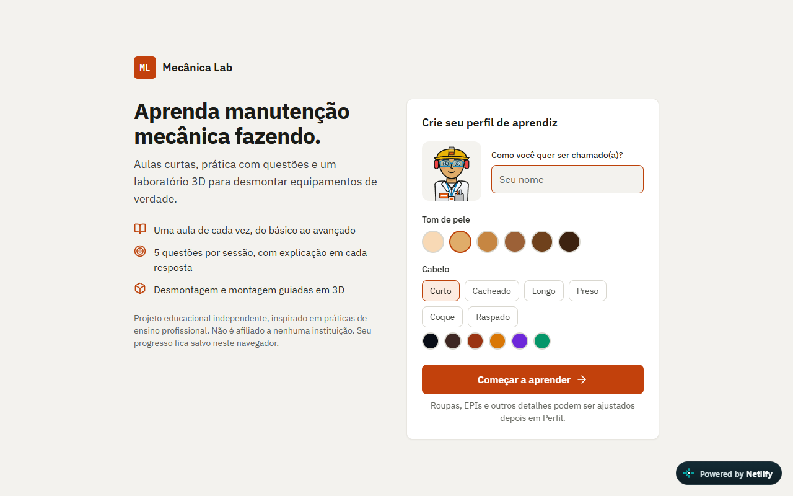

# Mecânica Lab

**Aprender mecânica industrial não precisa parar na teoria.**

Plataforma educacional interativa para o ensino técnico de mecânica. O aluno explora equipamentos, vê componentes em 3D, acompanha a desmontagem e a montagem de uma bomba centrífuga e testa o que aprendeu.

**[Abrir a demonstração](https://mecanica-lab-3d.netlify.app)**

> Projeto pessoal e independente, sem vínculo com nenhuma empresa ou instituição. Os dados são fictícios, e os modelos são educacionais e simplificados. Não substitui professor, oficina nem prática supervisionada.



## O que tem nele

- Oficina interativa em 2D, com mapa de estações.
- Laboratório 3D com seleção de componentes e desmontagem guiada de bomba centrífuga.
- Simulador de relógio comparador (TIR) e treino de paquímetro.
- Questões por tema, trilhas de aula e passaporte de competências salvo no navegador.

## Como funciona

- React, TypeScript e Vite.
- Three.js para o 3D e Phaser para a oficina 2D.
- Tailwind CSS na interface.
- Testes de ponta a ponta com Playwright.

## Como rodar

```bash
npm install
npm run dev
```

## Sobre

Criado com apoio de ferramentas de IA para código, imagens e renderização.
